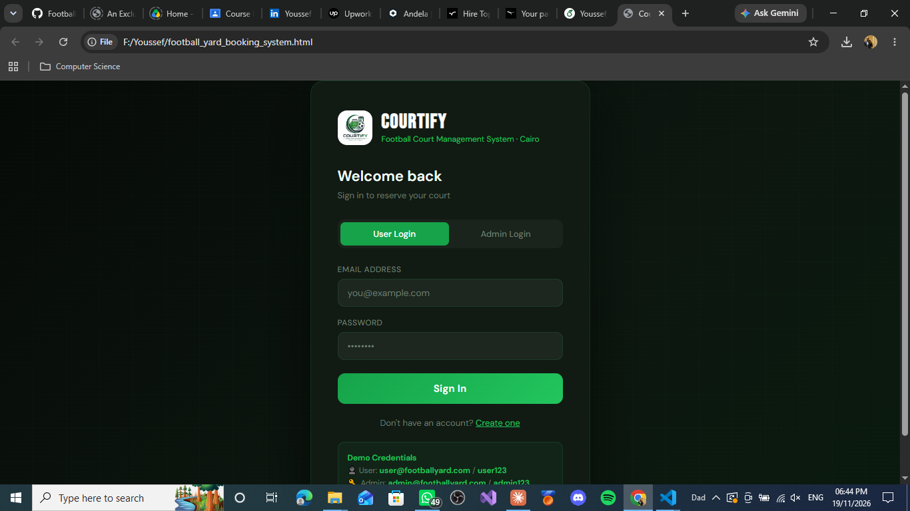
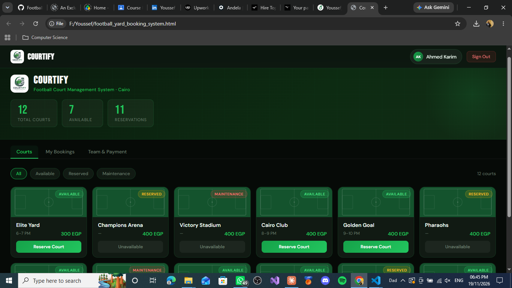
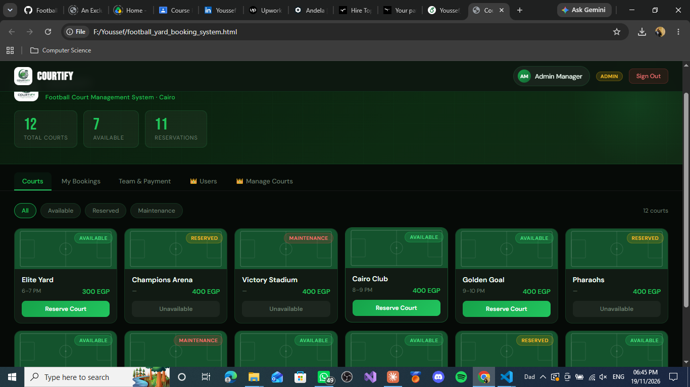

# Football Yard Booking (Courtify)

A front-end football court management and booking system for courts in Cairo. Users can browse courts, book them, and manage their bookings, while admins manage users and court availability.

> University project. Everything runs in the browser from a single `index.html` file (no backend or database), and the data is demo data.

## Features

**For users**
- Register and log in
- Browse available courts and filter them
- Reserve a court and view or cancel "My Bookings"
- Team page with a player list and a Join Team button
- Payment summary with a "Pay & Confirm Booking" button
- Simulated confirmation emails (welcome, booking, payment) shown in a pop-up

**For admins**
- Dashboard stats: total courts, available courts, reservations
- Manage users: edit and delete
- Manage courts: change a court's status (Available / Reserved)

## Technologies

- HTML5
- CSS3 (custom dark green theme, responsive layout)
- Vanilla JavaScript (no frameworks)

## How to Run

1. Download or clone the repository:
   ```
   git clone https://github.com/Raheel-21/Football_Yard_Booking.git
   ```
2. Open `index.html` in any browser (double-click it). No installation needed.

## Demo Accounts

| Role  | Email                     | Password  |
|-------|---------------------------|-----------|
| User  | user@footballyard.com     | user123   |
| Admin | admin@footballyard.com    | admin123  |

## Screenshots





## Notes

- Data is stored in memory only, so it resets when the page is refreshed.
- Emails are simulated in the UI and are not actually sent.

## Author

Youssef Mohamed Raheel — [GitHub](https://github.com/Raheel-21)
